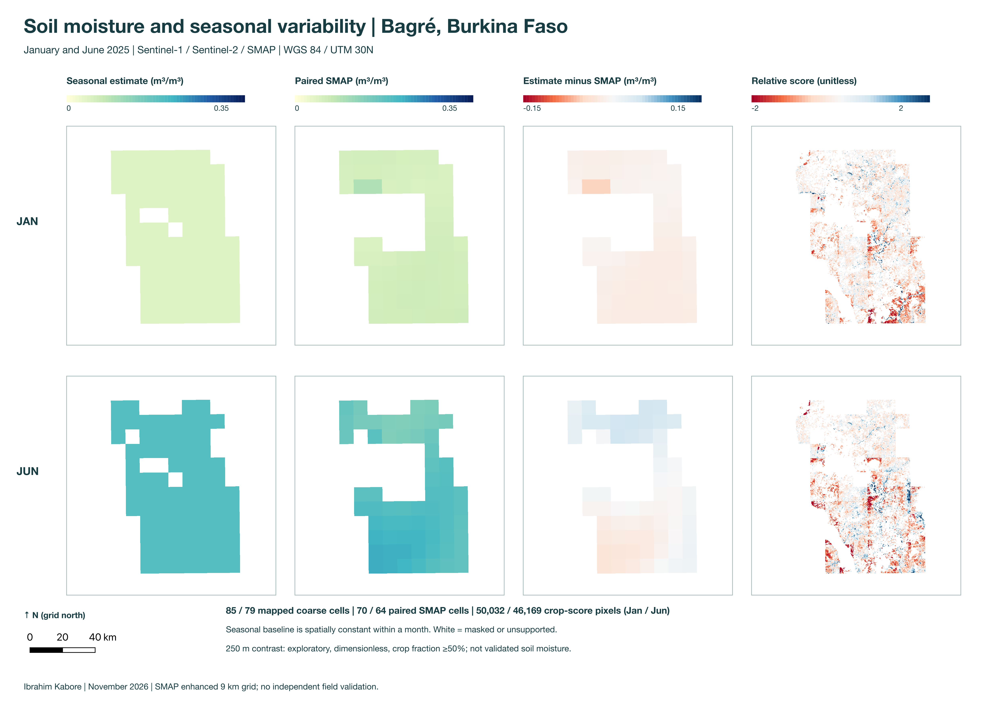

# Soil moisture beyond seasonality: Bagré, Burkina Faso

Independent CPU-based remote sensing project by Ibrahim Kabore (November 2026).

## Research question
Can monthly Sentinel-1 VV/VH and Sentinel-2 NDVI improve on a calendar-only prediction of SMAP surface soil moisture? Can the models explain spatial variability within months?

## Design
2024–2025 monthly data, ascending orbit 74, linear-power averaging, conservative optical cloud masks, WorldCover 2021 land/crop fractions, quality-screened SMAP L3 enhanced 9 km AM targets. Predictors aggregated from 250 m to the ingested SMAP grid. 1,750 of 2,880 core cell-month rows eligible; 463 train, 107 validation, 263 spatial, 629 temporal and 288 joint test. Only one eligible cell in August 2024. Samples are spatially and temporally correlated.

| Model | Spatial RMSE | Temporal RMSE | Joint RMSE | Joint R² |
|---|---:|---:|---:|---:|
| Seasonal baseline | 0.0346 | 0.0347 | 0.0342 | 0.8142 |
| SAR ridge | 0.0535 | 0.0601 | 0.0628 | 0.3729 |
| Fusion HGB | 0.0469 | 0.0537 | 0.0577 | 0.4709 |
| NDVI residual (exploratory, validation selected) | 0.0313 | 0.0320 | 0.0308 | 0.8489 |
| Fusion residual (exploratory) | 0.0293 | 0.0293 | 0.0290 | 0.8666 |

RMSE in m³/m³. Seasonal baseline won the original comparison. After inspecting the original holdouts, a post-hoc extension used fixed-penalty residual and additive ridge models. NDVI residual was selected on the original validation rows, not the test metrics. Fusion residual reduced joint MSE by 28.2% but was not validation-selected. Within-month spatial skill of NDVI residual was −10.9%, +5.6%, +7.5% on spatial, temporal and joint tests; SAR and fusion residuals were negative on all three. No independent confirmation of the post-hoc extension.

## Reproduce
Copy `code/` and `notebooks/` into `MyDrive/Bagre_SAR_Soil_Moisture`, run notebooks 01–07 in order using CPU Colab, and replace `YOUR_EARTH_ENGINE_PROJECT_ID` in notebooks 02–03 with a registered project. The monthly acquisition is cached; downloads can take hours. `results/` contains actual summary CSVs and `figures/` contains actual generated illustrations. Open `qgis/Bagre_SAR_2025.qgz` with its relative raster directory intact. The blog draft describes the findings and captions.

## Limitations
SMAP is a satellite reference, not ground truth; its effective footprint exceeds the posted grid. The 250 m map is a dimensionless scene-standardized fitted contrast, not an independently validated moisture retrieval. A calendar-only model cannot map within-month spatial variation. The original validation residual envelope is descriptive, not guaranteed. No field or root-zone inference. Independent future-year data are needed to confirm exploratory results.

Sources: [Sentinel-1](https://developers.google.com/earth-engine/datasets/catalog/COPERNICUS_S1_GRD), [Sentinel-2](https://developers.google.com/earth-engine/datasets/catalog/COPERNICUS_S2_SR_HARMONIZED), [SMAP](https://developers.google.com/earth-engine/datasets/catalog/NASA_SMAP_SPL3SMP_E_006), [WorldCover](https://developers.google.com/earth-engine/datasets/catalog/ESA_WorldCover_v200).
